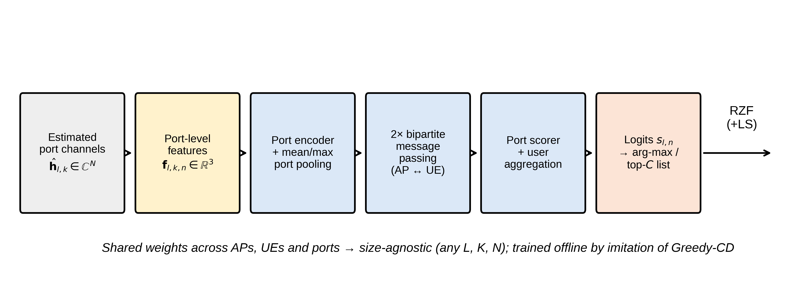

# FLARE: Graph Neural Network Port Selection for Fluid Antenna Enabled Cell Free Massive MIMO

Official code for the paper

> A. Bamila Virgin Louis, G. Arul Dalton and P. Sankar, "Scalable Graph Neural Network Port Selection and Beamforming for Fluid Antenna Enabled Cell Free Massive MIMO Under Imperfect Channel State Information," submitted to *Telecommunication Systems* (Springer).

FLARE (Fluid antenna Learning Aided Resource Engine) selects the active port of a single-RF-chain fluid antenna at every access point (AP) of a cell-free massive MIMO network, using only LMMSE channel estimates. It is a bipartite AP–user graph neural network that is equivariant to permutations of **APs, users and ports**, so one 15,777-parameter model runs on any network size. FLARE-LS adds a candidate-restricted local search. The repository also contains the overhead-aware, port-subsampled sounding scheme of Section 4.6.



## Key results (L = 16 APs, K = 6 users, N = 16 ports)

| Scheme | Sum SE (bit/s/Hz) | Share of Greedy-CD | Precoder evaluations |
|---|---|---|---|
| Fixed port | 38.19 | 79.3% | 0 |
| Max-gain | 46.73 | 97.0% | 0 |
| Greedy-CD (coordinate descent) | 48.18 | 100% | 512 |
| **FLARE** | **47.78** | **99.2%** | **0** |
| **FLARE-LS (C = 3)** | **48.12** | **99.9%** | **48** |

Once pilot overhead is charged, adaptive port sounding keeps FLARE ahead of a conventional fixed antenna for every coherence length from 100 to 2000 symbols, with gains of up to 32.8%.

## Repository layout

```
flare-fas-cellfree/
├── flarefas/                 # Python package
│   ├── system.py             # network, 3GPP UMi fading, Jakes ports, LMMSE, RZF, SE, baselines
│   └── model.py              # FLARE GNN, FLARE-LS, imitation training, save/load
├── scripts/
│   ├── train.py              # train FLARE (Sec. 4.3)
│   ├── evaluate.py           # Figs. 3–9, Tables 2–4
│   ├── overhead.py           # Table 5, Fig. 10 (port-subsampled sounding, Eq. 14)
│   └── diagrams.py           # Figs. 1–2
├── weights/                  # trained FLARE weights (.npz) and training history
├── results/                  # JSON with every number reported in the paper
├── figures/                  # generated figures (600 dpi PNG)
├── examples/quickstart.py    # 10-second demo
├── tests/test_flarefas.py    # unit tests, including a permutation-equivariance test
└── reproduce_all.sh          # regenerate all figures and tables
```

## Installation

Python 3.9 or newer. No GPU is needed.

```bash
git clone https://github.com/GArulDalton/flare-fas-cellfree.git
cd flare-fas-cellfree
python -m venv .venv && source .venv/bin/activate   # Windows: .venv\Scripts\activate
pip install -r requirements.txt
```

## Quick start

```bash
python examples/quickstart.py
```

Expected output (120 random networks):

```
Fixed port   average sum SE =  39.20 bit/s/Hz
Max-gain     average sum SE =  47.45 bit/s/Hz
Greedy-CD    average sum SE =  48.73 bit/s/Hz
FLARE        average sum SE =  48.54 bit/s/Hz
FLARE-LS     average sum SE =  48.86 bit/s/Hz
```

Using the package directly:

```python
import numpy as np, flarefas as F
P, _ = F.load_params('weights/flare_params.npz')
H, Hhat, _ = F.gen_batch(np.random.default_rng(0), 10, L=16, K=6, N=16)
ports = F.sel_flare(P, Hhat)              # (10, 16) active port per AP
W = F.rzf(F.select(Hhat, ports))          # RZF precoder with per-AP power
se = F.rates(F.select(H, ports), W).sum(1)
```

## Reproducing the paper

| Paper item | Command | Output |
|---|---|---|
| Figs. 1–2 | `python scripts/diagrams.py` | `figures/fig_system.png`, `fig_arch.png` |
| Training (Fig. 3) | `python scripts/train.py` | `weights/flare_params.npz` |
| Figs. 3–9, Tables 2–4 | `python scripts/evaluate.py` | `figures/`, `results/main_results.json` |
| Table 5, Fig. 10 | `python scripts/overhead.py` | `figures/fig_overhead.png`, `results/overhead_*.json` |
| Everything | `./reproduce_all.sh` (add `RETRAIN=1` to retrain) | all of the above |

All random seeds are fixed, so the scripts reproduce the published numbers exactly with the included weights. On a single CPU core, training takes about 12 minutes, `evaluate.py` about 5 minutes and `overhead.py` about 2 minutes. Use `python scripts/evaluate.py --quick` for a fast check.

## Simulation parameters

| Parameter | Value |
|---|---|
| Area; AP–UE height difference | 400 m × 400 m; 10 m |
| Carrier; bandwidth | 3.5 GHz; 20 MHz |
| Path loss; shadowing | 3GPP UMi, 31.9 log10(d); 8.2 dB |
| Per-AP power; noise figure | 23 dBm; 7 dB |
| Port correlation | Jakes, J0(2π·Δx/λ) |
| Default L, K, N, W, pilot power | 16, 6, 16, 2λ, 20 dBm |
| FLARE hidden size; parameters | 32; 15,777 |
| Training | 3,840 realizations, 25 epochs, Adam, lr 2×10⁻³ (cosine) |

## Tests

```bash
python -m pytest -q tests
```

The tests check shapes, per-AP power constraints, LMMSE quality, size-agnostic inference, a training smoke run and the permutation equivariance of FLARE over APs, users and ports.

## Citation

If you use this code, please cite the paper (see `CITATION.cff`). BibTeX will be updated with volume and DOI after publication.

```bibtex
@article{louis2026flare,
  author  = {Louis, A. Bamila Virgin and Arul Dalton, G. and Sankar, P.},
  title   = {Scalable Graph Neural Network Port Selection and Beamforming for Fluid Antenna Enabled Cell Free Massive {MIMO} Under Imperfect Channel State Information},
  journal = {Telecommunication Systems},
  note    = {Submitted},
  year    = {2026}
}
```

## License

MIT License. See `LICENSE`.

## Contact

A. Bamila Virgin Louis (corresponding author): bamilavirgin@sxcce.edu.in
G. Arul Dalton: aruldalton@saveetha.ac.in
